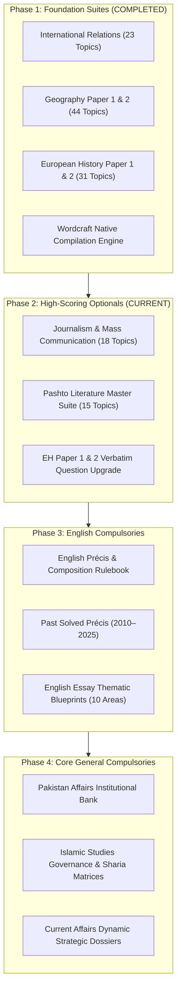

# 🏛️ KPPSC PMS Institutional Master Notes — Project Layout & Strategic Roadmap

> **Official Project Wiki & Execution Roadmap for Khyber Pakhtunkhwa Provincial Management Service (KPPSC PMS) and Federal Public Service Commission (CSS) Competitive Examinations.**

---

## 🎯 1. Project Mission & Strategic Vision

The **KPPSC PMS Master Study Notes Project** is an institutional-grade knowledge initiative engineered to bridge the critical gap in competitive civil service exam preparation in Khyber Pakhtunkhwa. 

Traditional market notes and guidebooks suffer from superficial coverage, descriptive summaries, outdated data, and an absence of examiner-rubric alignment. This project replaces fragmented study materials with **exhaustive, 5-to-7 page master responses (2,200 – 2,800 words)**, built to secure **top-percentile scores (16–18 out of 20 marks)** per question through:

1. **100% Verbatim Past Paper Linkage (2008–2025)**.
2. **Historiographical & Theoretical Grounding**.
3. **Monospace Visual Mind Maps & Conceptual Diagrams**.
4. **Structured Analytical & Chronological Matrices**.
5. **Authentic Theorist Quotation Banks (5 Verbatim Citations per Topic)**.
6. **Examiner Traps to Avoid & Strategic Scoring Rubrics**.

---

## 📊 2. Current Project Layout & Subject Inventory

The project currently encompasses **98 Master Topics** across completed optional suites, with an expanding pipeline for remaining optional and compulsory papers:

```
KPPSC PMS Curriculum Suite
│
├── 🟢 COMPLETED SUITES (Phase 1)
│   ├── International Relations (100 Marks)       -> 23 Topics [100% Past Papers 2013-2025]
│   ├── Geography Paper 1: Physical (100 Marks)   -> 20 Topics [100% Past Papers 2008-2025]
│   ├── Geography Paper 2: Human/Reg (100 Marks)  -> 24 Topics [100% Past Papers 2008-2025]
│   ├── European History Paper 1 (100 Marks)      -> 16 Topics [1789–1870 French Rev to Unification]
│   └── European History Paper 2 (100 Marks)      -> 15 Topics [1871–1960 Bismarck to Cold War]
│
├── 🟡 ACTIVE PIPELINE (Phase 2)
│   ├── Journalism & Mass Communication (100 M)   -> Syllabus Decomposed; Past Papers Cataloged
│   ├── Pashto Literature (100 Marks)             -> Poet Archives & Past MCQs Organized
│   └── European History Format Upgrade           -> Upgrading to Multi-Question Verbatim Table
│
└── ⚪ SCHEDULED COMPULSORIES (Phase 3 & 4)
    ├── English Précis & Composition (100 Marks)  -> Rule Engine & Past Solved Passages
    ├── English Essay (100 Marks)                 -> Thematic Argumentative Blueprints
    ├── Pakistan Affairs (100 Marks)              -> Pre/Post-Partition Institutional Q&A
    ├── Islamic Studies / Islamiat (100 Marks)    -> Governance, Human Rights & Quranic Matrices
    └── Current Affairs & General Knowledge       -> Structural Global Issues & Dynamic Factsheets
```

---

## 📐 3. The Institutional 5-Page Standard Specification

Every single master response generated across this project strictly enforces the **7-Part Architectural Standard**:

| Section | Component | Description & Pedagogical Purpose | Target Length / Format |
| :---: | :--- | :--- | :---: |
| **1** | **Unified Metadata Header** | States paper, subject, core syllabus theme, and theoretical lens. Includes **`EXAM QUESTIONS LINKED:`** quoting all 2008–2025 past papers verbatim with marks. | Structured Table |
| **2** | **Executive Exam Takeaways** | 3 to 5 punchy analytical thesis bullet points for rapid 60-second review outside the exam hall. | Bulleted Block |
| **3** | **Conceptual Flowchart / Mind Map** | Hierarchical ASCII tree tracing causal pathways, policy feedback loops, or geomorphological/historical sequences. | Monospace Code Block |
| **4** | **Structured Analytical Matrix** | 4 to 6 row analytical table contrasting theories, historical treaties, or regional socio-economic models. | Markdown Table |
| **5** | **Comprehensive Essay Body** | Academic introduction with historiographical hook, 6–8 numbered/bolded thematic sections packed with empirical citations, and an academic conclusion with forward-looking synthesis. | 2,200 – 2,800 Words |
| **6** | **Theorist Quotation Bank** | Exactly 5 genuine scholar quotations with scholar name, seminal work, publication year, and specific exam utility. | Formatted Matrix |
| **7** | **Strategic Recommendations** | 3 critical examiner traps to avoid and 3 high-scoring strategies (diagrams to sketch, primary treaties to cite). | Actionable Callout |

---

## 🗺️ 4. Strategic Milestone Roadmap



### Detailed Phase Execution Plan:

### 📍 Phase 1: Foundation Suites *(Completed & Verified)*
- [x] Ingest & catalog official KPPSC past papers (2008–2025).
- [x] Develop Python Wordcraft engine with executive palette (`#0E2B50` Navy, `#1B4965` Teal, 0.8-inch margins).
- [x] Generate 23 IR Master Topics (`.md`, `.docx`, `.pdf`) with 100% past-paper alignment.
- [x] Generate 20 Geography Paper 1 Topics (`.md`, `.docx`, `.pdf`).
- [x] Generate 24 Geography Paper 2 Topics (`.md`, `.docx`, `.pdf`).
- [x] Generate 31 European History Topics (`.md`, `.docx`, `.pdf`).
- [x] Setup and launch public GitHub repository: [`hafizmuhmmadismail/KPPSC-PMS-Master-Notes`](https://github.com/hafizmuhmmadismail/KPPSC-PMS-Master-Notes).

### 📍 Phase 2: High-Scoring Optional Subjects *(Current Execution)*
- [ ] **Milestone 2.1 — Journalism & Mass Communication (100 Marks)**:
  - Decompose syllabus into 18–20 Master Topics.
  - Ingest Mirza Muhammad Yousaf (*Exploring Journalism*) and Abid Teham references.
  - Cross-reference all KPPSC Journalism past paper questions.
  - Generate full triple-format (`.md`, `.docx`, `.pdf`) master notes.
- [ ] **Milestone 2.2 — Pashto Literature (100 Marks)**:
  - Structure classical poetry (Khushal Khan Khattak, Rahman Baba, Abdul Hamid Mashokhel).
  - Structure modern poetry & prose (Hamza Baba, Ghani Khan, modern drama/short stories).
  - Cross-reference Past Papers & compile proverbs and solved MCQs.
- [ ] **Milestone 2.3 — European History Verbatim Alignment Upgrade**:
  - Retrofit European History Papers 1 & 2 with the unified multi-year `EXAM QUESTIONS LINKED:` table row.

### 📍 Phase 3: English Compulsories *(Weeks 4–5)*
- [ ] **Milestone 3.1 — English Précis & Composition (100 Marks)**:
  - Rule-based précis writing methodology & 2008–2025 solved past précis passages.
  - Idioms, pair of words, prepositional phrases, and sentence correction banks.
- [ ] **Milestone 3.2 — English Essay (100 Marks)**:
  - 10 Comprehensive argumentative outlines across recurring themes (Governance, Education, Climate, Economy, AI & Tech, Foreign Policy).

### 📍 Phase 4: Core General Compulsories *(Weeks 6–8)*
- [ ] **Milestone 4.1 — Pakistan Affairs (100 Marks)**:
  - Constitutional evolution (1956, 1962, 1973, 18th Amendment).
  - Economic, foreign policy, and federal-provincial resource allocation issues.
- [ ] **Milestone 4.2 — Islamic Studies (100 Marks)**:
  - Quranic verses and Hadith citations with English/Urdu references.
  - Islam's socio-economic and political system compared with Western models.
- [ ] **Milestone 4.3 — Current Affairs & General Knowledge**:
  - Deconstructed global conflicts, regional diplomacy, and data dashboards.

---

## 🤖 5. The AI Agentic Architecture

The study notes are powered by a reproducible AI agentic pipeline:

```
Raw Exam Syllabus + Past Papers (2008–2025)
                  │
                  ▼
┌───────────────────────────────────┐
│     pms-exam-notes-processor      │  <- Ingestion, frequency weighting,
│             (Skill)               │     thematic clustering & mapping
└─────────────────┬─────────────────┘
                  │
                  ▼
┌───────────────────────────────────┐
│       pms-notes-architect         │  <- Enforces 7-section blueprint,
│             (Agent)               │     2,500 words, mindmaps, quotes
└─────────────────┬─────────────────┘
                  │
                  ▼
┌───────────────────────────────────┐
│     Wordcraft Compilation Engine   │  <- Compiles native .docx, .pdf,
│          (apps_toolkit)           │     and GitHub Flavored Markdown
└───────────────────────────────────┘
```

Colleagues who wish to extend this framework for other subjects can utilize the `.agents/` definitions and prompt structures committed directly to the repository root.

---

## 👥 6. Contribution & Study Guild Guidelines
- **Issue Tracker**: Use GitHub Issues to suggest new past-paper questions, empirical data updates, or corrections.
- **Pull Requests**: Welcomed for syllabus expansions, case-study enhancements, and complementary subject dossiers.
- **License**: Educational open-access repository for non-profit civil service aspirants.
